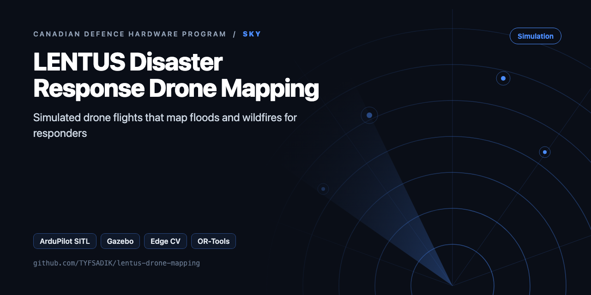
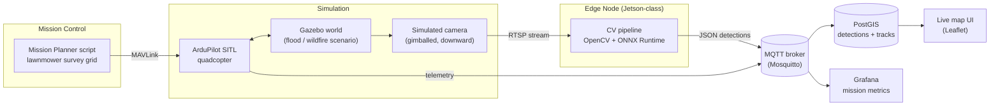

<div align="center">



# Operation LENTUS-Style Disaster Response Drone Mapping

**Simulated drone flights with ArduPilot SITL and Gazebo map floods or wildfires; edge computer vision detects affected areas and feeds a live awareness map.**

[](https://github.com/TYFSADIK/lentus-drone-mapping/actions/workflows/tests.yml)   [](LICENSE) [](https://github.com/TYFSADIK/defence-hardware-program)

[Build guide](docs/project-page.md) · [How it works](#how-it-works) · [Quick start](#quick-start) · [Program hub](https://github.com/TYFSADIK/defence-hardware-program)

</div>

## Overview

When floods hit the Fraser Valley or wildfires threaten a northern community, the first question incident command asks is simple: **where is the damage right now?** This project builds a prototype answer: a simulated quadcopter flies a survey pattern over a synthetic disaster area, detects affected zones (floodwater, burned ground, blocked roads) with computer vision running on an edge device, and publishes every detection to a live web map that an incident commander could watch in real time.

The whole thing runs in **simulation**. ArduPilot SITL (software in the loop) provides the autopilot, Gazebo provides the world and the camera feed, and open data (OpenStreetMap road networks, public flood extent layers) shapes the scenario. No real aircraft, no restricted data, no weapons logic of any kind. Everything is reproducible on a laptop and safe to publish.

The framing is deliberately Canadian: the Canadian Armed Forces regularly support domestic disaster response under **Operation LENTUS**, and small uncrewed aircraft are exactly the kind of asset that gets tasked for rapid damage assessment. This project is my way of learning the full chain, from flight planning to detection to common operating picture, that such a mission depends on.

## How it works



*Simulated flight, edge detection, and the path from detection to the shared map.*

## Quick start

```bash
pip install numpy
python demo.py && python -m unittest -v
```

Real output from the demo, run on simulated data:

```text
survey plan @80 m: {'gsd_cm': 2.7, 'footprint_m': (109.7, 80.9), 'line_spacing_m': 38.4, 'trigger_m': 20.2, 'trigger_s': 2.53, 'max_speed_ms_for_2s_interval': 10.1} -> 1x1 km in 62 min
flood: new-water IoU 0.97, affected 17.4% of tile
burn scar IoU 1.00
{"type": "FeatureCollection", "features": [{"type": "Feature", "geometry": {"type": "Polygon", "coordinates": [[[-75.6987206275323, 45.401796630568235], [-75.69 ...
```

## What's in this repo

| File | Purpose |
|---|---|
| `lentus/survey.py` | GSD, footprint, line spacing and trigger distance from overlap, area flight time |
| `lentus/detect.py` | Water index (RGB, or **NDWI** with NIR), excess-green burn scar, **Otsu** thresholds, before/after change (ignores rivers that were always there) |
| `lentus/awareness.py` | 100 m awareness grid with confidence and age. Sends only changed cells as GeoJSON, which suits degraded links |
| `lentus/synthetic.py` | Synthetic tiles (river, flood, burn scar) with ground truth for IoU |
| `sitl/fly_survey.py` | Uploads a lawnmower mission with distance-based camera triggers to ArduPilot SITL (pymavlink) |

## What you need

| Category | Item | Notes |
|----|----|----|
| Hardware | Any laptop or desktop | Simulation only; no airframe, no camera, no flight hardware needed |
| Software | ArduPilot SITL, Gazebo Garden, ardupilot_gazebo plugin, pymavlink or MAVProxy, OpenCV, ONNX Runtime, Mosquitto, PostGIS, FastAPI, Leaflet, Docker Compose, Google OR-Tools | All open source |
| Skills | Python, basic photogrammetry and georeferencing concepts, UAV mission-planning basics | Timestamp discipline matters more than computer-vision expertise at first |
| Accounts | None | FloodNet and the FLAME dataset are open labelled datasets for training and evaluating the segmentation model |

## Status

- **Done**: architecture design, SITL + Gazebo environment running in Docker, scripted lawnmower survey missions, RTSP camera feed into OpenCV.
- **In progress**: ONNX segmentation model selection and evaluation on FloodNet/FLAME, telemetry-synced georeferencing, MQTT detection publishing.
- **Next**: Leaflet situational-awareness map with live track and detection layers, de-duplication logic, then the OR-Tools resupply and casualty-evacuation route extension.

## Roadmap

- [ ] Gazebo world with a flood plane and a burn texture, and the camera plugin publishing images, so detections run in the loop
- [ ] Orthorectify each frame with pose (reuse `thermal-sar-drone/sar/georef.py` for footprints), or batch-process with OpenDroneMap
- [ ] Jetson or Hailo segmentation model (U-Net on FloodNet or similar) as the ML upgrade, keeping Otsu as a baseline to compare
- [ ] Send `geojson(only_dirty=True)` through the `ddil-proof-devops` outbox to a TAK or web map
- [ ] Score IoU against hand-labelled masks from a public flood dataset

## Related builds

- [Thermal SAR Drone](https://github.com/TYFSADIK/thermal-sar-drone), the real thermal quadcopter build for finding people in snow and brush.
- [Airspace Deconfliction Manager](https://github.com/TYFSADIK/airspace-deconfliction-manager), the tracker beacons and geofencing that keep mapping drones separated.
- [Canadian Defence Hardware Program](https://github.com/TYFSADIK/defence-hardware-program), the program hub with all 11 builds, phased BOMs, and build guides.

## Learn more

The full build guide, with step-by-step instructions, wiring, troubleshooting and lessons learned, is in [docs/project-page.md](docs/project-page.md). It is also published at [tyfsadik.org](https://tyfsadik.org/work/defence/lentus-drone-mapping.html).

## License

[MIT](LICENSE). Built by [Taki Sadik](https://tyfsadik.org) as part of the self-funded [Canadian Defence Hardware Program](https://github.com/TYFSADIK/defence-hardware-program).
