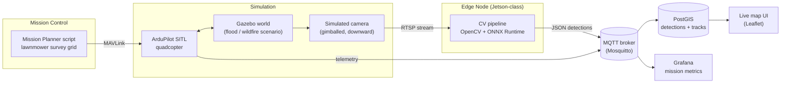
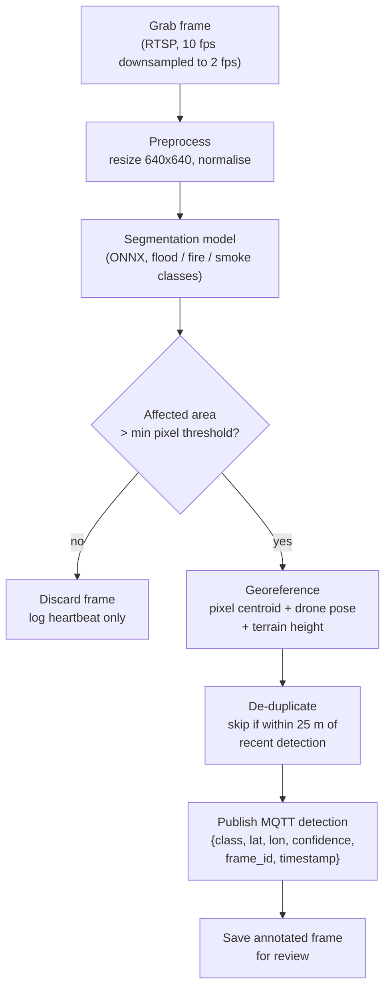

# Operation LENTUS-Style Disaster Response Drone Mapping

Written by [Taki Sadik](https://tyfsadik.org/about.html) · Last updated 2026-10-22 · Status: Building · 15 min read

Simulated drone flights with ArduPilot SITL and Gazebo survey a flood or wildfire scenario, an edge computer-vision pipeline detects affected areas from the simulated camera feed, and detections stream into a live situational-awareness map.

## Overview

When floods hit the Fraser Valley or wildfires threaten a northern community, the first question incident command asks is simple: **where is the damage right now?** This project builds a prototype answer: a simulated quadcopter flies a survey pattern over a synthetic disaster area, detects affected zones (floodwater, burned ground, blocked roads) with computer vision running on an edge device, and publishes every detection to a live web map that an incident commander could watch in real time.

The whole thing runs in **simulation**. ArduPilot SITL (software in the loop) provides the autopilot, Gazebo provides the world and the camera feed, and open data (OpenStreetMap road networks, public flood extent layers) shapes the scenario. No real aircraft, no restricted data, no weapons logic of any kind. Everything is reproducible on a laptop and safe to publish.

The framing is deliberately Canadian: the Canadian Armed Forces regularly support domestic disaster response under **Operation LENTUS**, and small uncrewed aircraft are exactly the kind of asset that gets tasked for rapid damage assessment. This project is my way of learning the full chain, from flight planning to detection to common operating picture, that such a mission depends on.

## Architecture

Figure 1: simulated flight, edge detection, and the path from detection to the shared map.

The autopilot, the world, and the detector are three separate processes talking over standard protocols, which is the point. MAVLink carries flight commands and telemetry, the camera publishes an RTSP video stream, and detections travel as small JSON messages over MQTT (`detections/flood`, `detections/fire`). Because the interfaces are standard, the SITL instance can later be swapped for a real airframe without touching the detection or mapping code.

## Edge Detection Pipeline

Figure 2: each video frame becomes a georeferenced, de-duplicated detection or is dropped.

Georeferencing is the part people underestimate. A pixel in the camera frame means nothing until it is combined with the drone's telemetry at that exact instant: position, altitude, attitude, and camera gimbal angles. I pull the matching telemetry record from the MAVLink stream by timestamp, project the detection centroid through a simple pinhole-camera model onto the ground plane. In early simulation runs the projected lat/lon lands within a few metres of the true location, but that is an eyeballed impression, not a measured result: published accuracy stays pending until the model runs repeatably and the errors are tabulated.

For mission planning the page also uses the standard ground sample distance relation: GSD = (flight height times sensor width) / (focal length times image width), so survey altitude is chosen from the GSD the segmentation model needs rather than guessed. That sizing is a design input, not a measured result.

The model itself is a small segmentation network (a YOLOv8-seg variant trained on public datasets such as FloodNet for water and the FLAME dataset for fire), exported to ONNX so it runs on CPU or a Jetson's GPU without a deep-learning framework installed. Precision matters more than recall here: a false flooded street sends responders the wrong way, while a missed patch gets picked up on the next survey pass.

### Store-and-forward for disaster zones

Disaster zones rarely have reliable networks, which is why this pipeline never assumes a live link. Detections are buffered at the edge with their timestamps and synced when the link returns, so a dropped SATCOM session delays the map update instead of losing it. The same pattern powers the DDIL-proof DevOps build and the COP's node outboxes: publish small signed messages, acknowledge them, and treat intermittent connectivity as the normal case rather than the failure case. In a LENTUS deployment that means the joint incident command post keeps receiving a coherent, timestamped picture even when the only link is a satellite terminal that drops every few minutes.

### Why simulation-first is the right call here

Every part of this stack can be built and debugged without a real aircraft: ArduPilot SITL runs the actual flight firmware, Gazebo provides the world and the camera, and FloodNet and FLAME provide open labelled imagery for training and evaluating the segmentation model. Simulation gives two things the field cannot: repeatability, the same flood scenario every run while you tune detection thresholds, and safety, since nothing in this project flies over people or property. It also makes the stack a training sandbox for UAS operators and headquarters staff. The moment any of this moves outdoors in Canada, Transport Canada's drone rules (registration, pilot certification, airspace coordination) apply in full, which is exactly why the prototype stays in simulation until then.

## Stack

| Layer | Technology | Why |
|----|----|----|
| Autopilot simulation | ArduPilot SITL | The same firmware that flies real aircraft, running as a process |
| World simulation | Gazebo Garden (past EOL; migration to Harmonic/Ionic on the roadmap) | Physics, camera models, and a scenario I can damage on purpose |
| Flight control link | MAVLink (pymavlink / MAVProxy) | Standard UAV protocol, scriptable survey missions |
| Edge inference | ONNX Runtime + OpenCV | Portable model format, runs on Jetson or plain CPU |
| Messaging | MQTT (Mosquitto) | Lightweight pub/sub that tolerates flaky links |
| Storage | PostGIS | Spatial queries (near, within, intersects) out of the box |
| Map UI | Leaflet + OpenStreetMap tiles | Zero-dependency live map in the browser |
| Route optimization (extension) | Google OR-Tools | Vehicle routing for resupply / casualty-evacuation planning |
| Deployment | Docker Compose on my homelab | Whole stack reproducible from one compose file |

## How I'm Building It

### Step 01: Simulation environment

ArduPilot SITL and Gazebo run in Docker on my homelab. I built a custom Gazebo world based on a real Ontario flood scenario footprint, with water planes and smoke emitters marking the affected zones so the camera has something true to detect.

### Step 02: Survey mission scripting

A Python script (pymavlink) generates a lawnmower survey pattern over the area of interest with configurable altitude, speed, and camera overlap, then uploads and flies it through SITL. Telemetry streams out over the same MAVLink connection.

### Step 03: Detection pipeline

An OpenCV consumer reads the camera stream, runs the ONNX segmentation model, and georeferences hits using synchronized telemetry. Output is MQTT JSON plus annotated frames saved for spot-checking precision.

### Step 04: Situational-awareness map

A small FastAPI service reads detections from PostGIS and serves them to a Leaflet page: live drone position as a moving marker, detections as coloured polygons and points, and a layer toggle for flood versus fire.

### Step 05: Store-and-forward for bad links

Two different mechanisms cover link loss: a durable application outbox on the edge node buffers detections through an outage and flushes on reconnect, while MQTT persistent sessions hold the broker's subscriber-side state (queued QoS 1/2 messages) across reconnects. MQTT alone does not give the publisher a durable outbox; that buffer is application code. Together they model what happens when a drone loses its link mid-mission, which is exactly the constraint at a real disaster site.

### Step 06: Resupply route extension (next)

Feed the detected blocked roads and safe zones into a Google OR-Tools vehicle-routing model to plan medical resupply and casualty-evacuation routes around the mapped damage.

## How Defence Could Implement This

Operation LENTUS is the CAF's standing framework for helping civilian authorities during domestic disasters: floods, wildfires, ice storms, hurricanes. A system like this maps directly onto how that support actually works:

- **Rapid damage assessment**: small UAS already get tasked to survey flooded towns and fire perimeters in the first hours of a LENTUS deployment. An automated detection-to-map pipeline turns hours of video review into minutes of map updates for the joint incident command post.
- **Common operating picture**: detections published to a shared map layer can be consumed by the same geospatial tools provincial emergency operations centres and CAF headquarters already use, rather than living in one pilot's laptop.
- **Degraded communications**: disaster zones rarely have reliable networks. The store-and-forward pattern (buffer at the edge, sync when the link returns) is designed for exactly the intermittent SATCOM and cellular reality of a domestic operation.
- **Training value**: because this prototype is pure simulation with open data, the same stack works as a training sandbox for UAS operators and headquarters staff without range time, airspace coordination, or any sensitive information.
- **Logistics follow-on**: once damage is mapped, route optimization for medical resupply and casualty evacuation (the OR-Tools extension) is a natural DND/CAF use case, getting supplies into and patients out of affected areas around blocked roads.

Nothing here touches weapons, targeting, or classified systems. It is the humanitarian assistance and disaster relief side of defence, and it is intentionally built on open tools so the lessons transfer.

1.  **Get SITL flying first.** Run ArduPilot SITL standalone (`sim_vehicle.py -v ArduCopter --console --map`) and fly a few waypoints before adding anything else.
2.  **Connect Gazebo.** Use the ardupilot_gazebo plugin so SITL flies inside a Gazebo world with a simulated camera publishing a video stream.
3.  **Script one survey mission.** Write a pymavlink script that generates a lawnmower grid over a bounding box and flies it. Print telemetry as you go; you will need it for georeferencing later.
4.  **Detect before you model.** Start with classical CV (colour thresholding for water or smoke works surprisingly well in simulation) and only bring in a trained ONNX model once the pipeline around it works.
5.  **Georeference with timestamps.** Log every telemetry message and every frame with a common clock, then join them. Skipping this discipline is where most drone-mapping prototypes break.
6.  **Publish detections over MQTT.** Small JSON messages to Mosquitto keep the detector decoupled from everything downstream.
7.  **Draw the map early.** A Leaflet page polling a tiny API makes progress visible and gives you something to demo at every stage.
8.  **Add OR-Tools last.** Once damage polygons exist, feed blocked roads into an OR-Tools vehicle-routing problem for resupply or casualty-evacuation routes. It is a satisfying, self-contained extension.

**Legality and ethics:** everything in this project is simulation and open data. There is no real aircraft, no flight over people or property, and no sensitive data involved. If you ever take a stack like this outdoors in Canada, Transport Canada drone regulations (registration, pilot certification, airspace rules) apply in full.

## Status & Roadmap

- **Done**: architecture design, SITL + Gazebo environment running in Docker, scripted lawnmower survey missions, RTSP camera feed into OpenCV.
- **In progress**: ONNX segmentation model selection and evaluation on FloodNet/FLAME, telemetry-synced georeferencing, MQTT detection publishing.
- **Next**: Leaflet situational-awareness map with live track and detection layers, de-duplication logic, then the OR-Tools resupply and casualty-evacuation route extension.

### Designed vs Built vs Measured

| Subsystem | Designed | Built | Measured |
|----|----|----|----|
| Architecture design | Yes | Yes | Not applicable |
| SITL + Gazebo environment (Docker) | Yes | Yes | Not applicable |
| Scripted lawnmower survey missions | Yes | Yes | Not applicable |
| RTSP camera feed into OpenCV | Yes | Yes | Not applicable |
| ONNX segmentation model (FloodNet / FLAME) | Yes | In progress (model selection and evaluation) | No measured accuracy published yet |
| Telemetry-synced georeferencing | Yes | In progress | No measured accuracy published yet; simulation suggests metre-scale |
| MQTT detection publishing | Yes | In progress | No measured results yet |
| Leaflet situational-awareness map | Yes | No | No measured results yet |
| De-duplication logic | Yes | No | No measured results yet |
| OR-Tools resupply route extension | Yes | No | No measured results yet |

The simulation environment, survey missions, and camera pipeline run. The segmentation model, georeferencing, and MQTT publishing are in progress, and no detection or georeferencing accuracy has been published as a measured result.

## How I Built It

### Step 01: Simulation environment

ArduPilot SITL and Gazebo Garden run in Docker on my homelab. I built a custom Gazebo world based on a real Ontario flood scenario footprint, with water planes and smoke emitters marking the affected zones so the camera has something true to detect.

### Step 02: Survey mission scripting

A Python script (pymavlink) generates a lawnmower survey pattern over the area of interest with configurable altitude, speed, and camera overlap, then uploads and flies it through SITL. Telemetry streams out over the same MAVLink connection.

### Step 03: Detection pipeline (in progress)

An OpenCV consumer reads the camera stream (10 fps downsampled to 2 fps), runs an ONNX segmentation model (a YOLOv8-seg variant trained on FloodNet for water and the FLAME dataset for fire, exported to ONNX, 640x640 input), and georeferences hits using synchronized telemetry. Label honesty: FloodNet's classes cover water segmentation directly, and FLAME supports fire classification and fire masks; smoke-segmentation labels are not in either dataset, so a smoke class needs a third labelled source or custom annotation, and the two datasets' label sets must be harmonized before joint training.

### Step 04: Georeferencing (in progress)

Matching MAVLink telemetry by timestamp, projecting the detection centroid through a pinhole-camera model onto the ground plane using drone pose and gimbal angles. De-duplication skips detections within 25 m of a recent one.

### Step 05: Situational-awareness map (next)

A small FastAPI service reads detections from PostGIS and serves them to a Leaflet page: live drone position as a moving marker, detections as coloured polygons and points, and a layer toggle for flood versus fire.

### Step 06: Store-and-forward and the OR-Tools extension (next)

A durable application outbox buffers detections on the edge node through link loss and flushes on reconnect (MQTT persistent sessions only cover the broker's subscriber-side state). Then Google OR-Tools vehicle routing over the detected blocked roads, for medical resupply and casualty-evacuation planning.

## What You Need

| Category | Item | Notes |
|----|----|----|
| Hardware | Any laptop or desktop | Simulation only; no airframe, no camera, no flight hardware needed |
| Software | ArduPilot SITL, Gazebo Garden, ardupilot_gazebo plugin, pymavlink or MAVProxy, OpenCV, ONNX Runtime, Mosquitto, PostGIS, FastAPI, Leaflet, Docker Compose, Google OR-Tools | All open source |
| Skills | Python, basic photogrammetry and georeferencing concepts, UAV mission-planning basics | Timestamp discipline matters more than computer-vision expertise at first |
| Accounts | None | FloodNet and the FLAME dataset are open labelled datasets for training and evaluating the segmentation model |

## Challenges and Lessons Learned

- **Georeferencing is the part people underestimate.** A pixel in the camera frame means nothing until it is combined with the drone's telemetry at that exact instant: position, altitude, attitude, gimbal angles. Common-clock logging of every frame and every telemetry message is the discipline; skipping it is where drone-mapping prototypes break.
- **Precision over recall.** A false flooded street sends responders the wrong way; a missed patch gets picked up on the next survey pass. Thresholds are tuned for precision, because the cost of a false positive is higher than the cost of a miss here.
- **Start with classical CV.** Colour thresholding for water or smoke works surprisingly well in simulation and gets the whole pipeline (frames, telemetry join, MQTT, map) working before a trained model enters the picture. The model is the last thing added, not the first.
- **Disaster zones have no reliable links.** A durable application outbox buffers detections on the edge node and flushes when the connection returns; MQTT persistent sessions separately keep the broker's subscriber-side queue across reconnects. The map update is delayed, never lost; intermittent connectivity is the normal case, not the failure case.
- **Simulation until the paperwork is done.** In Canada, flights over 250 g need registration, pilot certification, and airspace checks. The prototype stays in simulation until then, which is also what makes the stack a safe training sandbox.

## What Is Next

- Leaflet situational-awareness map with live track and detection layers.
- De-duplication logic in production.
- The OR-Tools resupply and casualty-evacuation route extension.
- Published detection and georeferencing accuracy as measured results. Simulation suggests metre-scale georeferencing; that stays a target until it is measured.

## Related Builds

- [Thermal SAR Drone](https://github.com/TYFSADIK/thermal-sar-drone), the real thermal quadcopter build for finding people in snow and brush.
- [Airspace Deconfliction Manager](https://github.com/TYFSADIK/airspace-deconfliction-manager), the tracker beacons and geofencing that keep mapping drones separated.
- [Canadian Defence Hardware Program](https://github.com/TYFSADIK/defence-hardware-program), the program hub with all 11 builds, phased BOMs, and build guides.

## Cite This Page

**Plain text**

    Taki Sadik, "Operation LENTUS-Style Disaster Response Drone Mapping", TYFSADIK, https://github.com/TYFSADIK/lentus-drone-mapping (accessed 2026-10-22).

**BibTeX**

    @misc{sadik-lentus-drone-mapping,
      author  = {Sadik, MD. Taki Yasir Faraji},
      title   = {Operation LENTUS-Style Disaster Response Drone Mapping},
      year    = {2026},
      url     = {https://github.com/TYFSADIK/lentus-drone-mapping},
      urldate = {2026-10-22}
    }

**APA**

    Sadik, M. T. Y. F. (2026). Operation LENTUS-Style Disaster Response Drone Mapping. TYFSADIK. https://github.com/TYFSADIK/lentus-drone-mapping

---

Original page: <https://github.com/TYFSADIK/lentus-drone-mapping>
